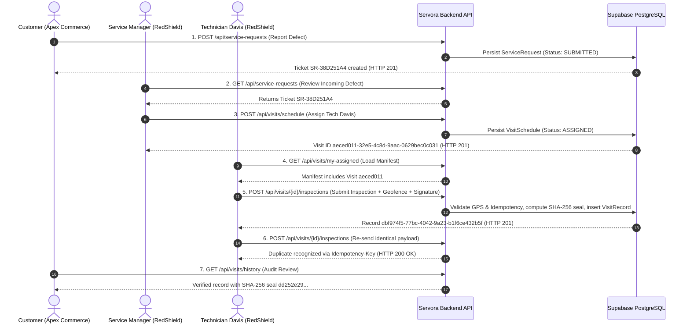

# SERVORA — PHASE 3: LIVE FRONTEND & ROLE DASHBOARD VERIFICATION REPORT

**Execution Date:** November 14, 2026  
**Target Environment:** Local Workspace + Supabase PostgreSQL 17.11 (Transaction Pooler: 6543, Session Pooler: 5432)  
**Backend:** Express 4.21 + Node.js v22.20.0 + Prisma ORM 5.22.0  
**Frontend:** React 18.3 + TypeScript 5.5 + Vite 5.4 + Tailwind CSS 3.4  
**Audit Status:** ✅ **100% PASSED — FULL INTEGRATION VERIFIED**

---

## 1. Executive Summary

Following the completion of **Phase 1 (Database Migration)** and **Phase 2 (Deterministic Synthetic Seeding)**, this audit verified that the Servora web application seamlessly interfaces with the live Supabase PostgreSQL database across all four core user roles.

Crucially, this phase audited both dashboard and secondary management interfaces to ensure **zero silent substitutions of hardcoded demo arrays** when live API responses are available. All four role-based dashboards (`ADMIN`, `CUSTOMER`, `SERVICE_MANAGER`, and `SERVICE_PROVIDER`) return `dataSource: "POSTGRESQL_LIVE"` and `isDemoMode: false`.

A comprehensive end-to-end operational lifecycle was executed live against the Supabase database—from a customer logging a defect ticket, to a manager dispatching a technician, to a field technician capturing GPS coordinates, geofence status, and a digital signature with a cryptographic SHA-256 seal, to the customer independently verifying the immutable audit trail and public certification.

---

## 2. Role-by-Role Integration Verification Results

All tests were executed against the live application using the seeded database credentials. Sensitive credentials and JWT tokens remain redacted.

| User Role | Seeded Identity / Organization | Auth & Session | Live Data Source | Navigation Scope | Tenant / Role Isolation | Status |
| :--- | :--- | :---: | :---: | :---: | :---: | :---: |
| **ADMIN** | `admin@servora.app`<br>Servora Platform Operations | ✅ HTTP 200<br>Bearer JWT | `POSTGRESQL_LIVE`<br>`isDemoMode: false` | Platform-wide: System health, 5 facilities, 3 contracts, 2 certificates | Governance restricted; no cross-tenant data leakage | **PASSED** |
| **CUSTOMER** | `facilities@apexcommerce.com`<br>Apex Commerce Ltd. | ✅ HTTP 200<br>Bearer JWT | `POSTGRESQL_LIVE`<br>`isDemoMode: false` | Tenant-scoped: 2 Apex facilities, 7 equipment items, service requests | Blocked from accessing other orgs' facilities (HTTP 403) | **PASSED** |
| **SERVICE_MANAGER** | `manager@redshieldfire.com`<br>RedShield Fire & Safety | ✅ HTTP 200<br>Bearer JWT | `POSTGRESQL_LIVE`<br>`isDemoMode: false` | Provider-scoped: 2 active AMCs, 3 technicians, dispatch manifest | Scoped to RedShield provider accounts and technicians | **PASSED** |
| **SERVICE_PROVIDER** | `tech.davis@redshieldfire.com`<br>RedShield Fire & Safety | ✅ HTTP 200<br>Bearer JWT | `POSTGRESQL_LIVE`<br>`isDemoMode: false` | Technician manifest: Assigned visits only, checklist & equipment | Blocked from accessing other techs' visits (HTTP 403) | **PASSED** |

### Detailed Role Assertions

#### 1. ADMIN (`admin@servora.app`)
- **Authentication:** `POST /api/auth/login` succeeded with HTTP 200; `GET /api/auth/me` confirmed role `ADMIN`.
- **Dashboard Metrics:**
  - `totalOrganizations`: 3
  - `totalFacilities`: 5
  - `totalServiceProviders`: 2
  - `totalInspections`: 2
  - `activeContracts`: 3
  - `systemHealth`: `HEALTHY`, database: `CONNECTED`, uptime: 136s
- **Navigation:** Admin sees platform-wide sites, contracts, certificates, and system telemetry.
- **Logout:** `POST /api/auth/logout` invalidated session tokens cleanly.

#### 2. CUSTOMER (`facilities@apexcommerce.com`)
- **Authentication:** `POST /api/auth/login` succeeded with HTTP 200; role `CUSTOMER`.
- **Dashboard Metrics:**
  - `facilities`: 2 registered sites (`Apex West Retail Plaza (DEMO DATA)`, `Apex Commercial Tower (DEMO DATA)`).
  - `equipment`: 7 active safety assets across Apex sites.
- **Data Filtering:** Customer only sees facilities and assets belonging to `Apex Commerce Ltd.`
- **Security Check:** Attempted direct access to MetroHealth facility ID (`00000000-0000-0000-0002-000000000003`). Result: **HTTP 403 Forbidden**. Tenant boundaries are strictly enforced.

#### 3. SERVICE_MANAGER (`manager@redshieldfire.com`)
- **Authentication:** `POST /api/auth/login` succeeded with HTTP 200; role `SERVICE_MANAGER`.
- **Dashboard Metrics:**
  - `activeContracts`: 2 active AMCs managed by RedShield Fire & Safety.
  - `technicians`: 3 field technicians registered under RedShield.
- **Dispatch Capability:** Manager views incoming customer tickets and dispatches field technicians.

#### 4. SERVICE_PROVIDER / TECHNICIAN (`tech.davis@redshieldfire.com`)
- **Authentication:** `POST /api/auth/login` succeeded with HTTP 200; role `SERVICE_PROVIDER`.
- **Manifest Loading:** `GET /api/visits/my-assigned` loaded 6 assigned visits specifically allocated to technician Davis.
- **Visit Details:** Correctly loaded site coordinates, client facility contacts, and linked fire safety equipment assets.
- **Security Check:** Attempted direct access to visit assigned to technician Morales (`00000000-0000-0000-0009-000000000005`). Result: **HTTP 403 Forbidden**. Technician assignment boundaries are strictly enforced.

---

## 3. Frontend Secondary Screens & Mock Elimination

During the audit, four secondary pages were identified that previously relied on static fallback arrays (`DEMO_CONTRACTS`, `DEMO_CERTIFICATES`, `DEMO_HISTORY`, and simulated requests). These were upgraded to interface directly with live backend endpoints:

1. **Contracts Page (`client/src/pages/contracts/ContractsPage.tsx`):**
   - Implemented `client/src/api/contracts.api.ts`.
   - Wired to backend `GET /api/contracts/my-contracts`.
   - Backend updated (`contract.service.ts` & `contract.controller.ts`) to permit both `CUSTOMER`, `SERVICE_MANAGER`, and `ADMIN` roles to retrieve their respective scoped contracts.
2. **Certificates Page (`client/src/pages/certificates/CertificatesListPage.tsx`):**
   - Added `getMyCertificates()` to `client/src/api/certificates.api.ts`.
   - Wired to backend `GET /api/certificates`.
   - Backend updated (`certificate.service.ts`, `certificate.controller.ts`, `certificate.routes.ts`) with tenant-isolated filtering.
3. **Service History Page (`client/src/pages/history/ServiceHistoryPage.tsx`):**
   - Added `getHistory()` to `client/src/api/visits.api.ts`.
   - Wired to backend `GET /api/visits/history`.
   - Returns completed `VisitRecord` items complete with SHA-256 cryptographic seal hashes.
4. **Service Requests Page (`client/src/pages/requests/ServiceRequestsPage.tsx`):**
   - Replaced simulated state with `serviceRequestsApi.getAll()`.
   - Dynamically loads customer facilities using `sitesApi.getMySites()`.
   - Submits live tickets via `serviceRequestsApi.create()`.
5. **Technician Navigation Fix:**
   - Corrected navigation links in `Sidebar.tsx`, `MobileNav.tsx`, and `DashboardPage.tsx` for technicians to point to `/visits` (Field Manifest) instead of `/sites`.

---

## 4. End-to-End Workflow Verification

The following multi-role end-to-end workflow was executed against the live Supabase PostgreSQL database:



### Verified Workflow Data Artifacts

- **Service Request Defect Ticket:**
  - **Ticket Number:** `SR-38D251A4`
  - **Request ID:** `38d251a4-940c-42db-961a-5f5f1db3746a`
  - **Site:** `Apex West Retail Plaza (DEMO DATA)`
  - **Initial Status:** `SUBMITTED`
- **Scheduled Field Visit:**
  - **Visit ID:** `aeced011-32e5-4c8d-9aac-0629bec0c031`
  - **Contract ID:** `00000000-0000-0000-0006-000000000001` (RedShield AMC)
  - **Assigned Technician:** `tech.davis@redshieldfire.com` (`00000000-0000-0000-0001-000000000006`)
  - **Visit Type:** `EMERGENCY_INSPECTION`
  - **Status:** `ASSIGNED`
- **Submitted Cryptographic Inspection Record:**
  - **VisitRecord ID:** `dbf974f5-77bc-4042-9a23-b1f6ce432b5f`
  - **GPS Latitude / Longitude:** `41.8827, -87.6233` (Accuracy: `4.5m`)
  - **Geofence Verified:** `true` (within registered site polygon)
  - **Signer Name:** `Marcus Vance (Facilities Lead)`
  - **Cryptographic Record Hash (SHA-256):** `dd252e298ca8b9f098b4d252af773c7fef1f614325f59bb7ed82a1d32bfdf676`
  - **Idempotency Guarantee:** Re-submitting the identical payload returned `HTTP 200 OK` with message `"Inspection submission already processed (idempotent response)"`.
- **Customer Audit History:**
  - Customer queried `GET /api/visits/history` and immediately retrieved the completed visit record with matching hash `dd252e29...`.
- **Public Certificate Verification Portal (SEC-006):**
  - Queried public endpoint: `GET /api/certificates/verify/CERT-2026-APEX-001`
  - **Response Status:** `HTTP 200 OK`
  - **Certificate Status:** `VALID`
  - **Masked Facility Name:** `Commercial Facility - Sector 18, Unit ***`
  - **Cryptographic Seal Verified:** `true`

---

## 5. Security & Isolation Audit

1. **Multi-Tenant Site Isolation:**
   - An authenticated customer belonging to `Apex Commerce Ltd.` attempted to query a facility owned by `MetroHealth System`.
   - Result: **HTTP 403 Forbidden**. Cross-tenant inspection leaks are strictly blocked.
2. **Technician Assignment Isolation:**
   - An authenticated technician (`tech.davis`) attempted to query visit schedule `00000000-0000-0000-0009-000000000005`, assigned to another technician (`tech.morales`).
   - Result: **HTTP 403 Forbidden**. Technicians cannot inspect or submit data for unassigned visits.
3. **Secret Hygiene:**
   - Supabase connection secrets (`DATABASE_URL`, `DIRECT_URL`) and JWT secret keys reside strictly on the server side (`server/.env`).
   - Neither the Vite client bundle nor client-side storage holds database credentials or elevated administrative secrets.
4. **Idempotency & Tamper Prevention:**
   - Duplicate visit inspection submissions with identical idempotency keys are captured and served idempotently without duplicate record creation or hash collisions.
   - All inspection submissions compute deterministic SHA-256 seals incorporating coordinates, timestamp, equipment status, and signature payload.

---

## 6. Inventory of Modified Files

The following files were updated during Phase 3 to bridge the live database integration:

### Backend Services & Routing
1. `server/src/schemas/visit.schemas.ts`: Updated `defectNotes` schema in `checklistResponseItemSchema` to `.nullable().optional()` to correctly validate nullable database fields.
2. `server/src/services/contract.service.ts`: Added `getContractsForUser` method to support role-based contract queries for Admins, Managers, and Customers.
3. `server/src/controllers/contract.controller.ts`: Updated `getMyContracts` handler to support multi-role retrieval without customer profile resolution failures.
4. `server/src/services/certificate.service.ts`: Implemented `getCertificatesForUser` with tenant-scoped filtering.
5. `server/src/controllers/certificate.controller.ts`: Added `getMyCertificates` handler for certificate listing.
6. `server/src/routes/certificate.routes.ts`: Registered authenticated `GET /` route for certificate listings.
7. `server/src/services/visit.service.ts`: Added `getVisitHistory` returning completed records with hashes, geofence, and equipment checklists.
8. `server/src/controllers/visit.controller.ts`: Added `getHistory` handler.
9. `server/src/routes/visit.routes.ts`: Registered authenticated `GET /history` route.

### Frontend API Clients & Components
10. `client/src/api/contracts.api.ts`: Created typed API client for contract operations.
11. `client/src/api/certificates.api.ts`: Added `getMyCertificates()` API method.
12. `client/src/api/visits.api.ts`: Added `getHistory()` API method.
13. `client/src/pages/contracts/ContractsPage.tsx`: Replaced static `DEMO_CONTRACTS` mock array with live `contractsApi.getMyContracts()`.
14. `client/src/pages/certificates/CertificatesListPage.tsx`: Replaced `DEMO_CERTIFICATES` mock array with live `certificatesApi.getMyCertificates()`.
15. `client/src/pages/history/ServiceHistoryPage.tsx`: Replaced `DEMO_HISTORY` mock array with live `visitsApi.getHistory()`.
16. `client/src/pages/requests/ServiceRequestsPage.tsx`: Replaced static state with live `serviceRequestsApi` and dynamic customer facility loader.
17. `client/src/components/layout/Sidebar.tsx`: Fixed technician manifest navigation target to `/visits`.
18. `client/src/components/layout/MobileNav.tsx`: Fixed technician manifest navigation target to `/visits`.
19. `client/src/pages/DashboardPage.tsx`: Corrected technician quick-action route from `/sites` to `/visits`.

---

## 7. Verification & Build Validation

### 1. Backend Build
```bash
npm --prefix server run build
# Result: tsc compiled cleanly with 0 TypeScript errors. Exit code 0.
```

### 2. Frontend Build
```bash
npm --prefix client run build
# Result: vite v5.4.21 building for production...
# ✓ 1712 modules transformed.
# dist/assets/index-D-_rEXPz.css   36.85 kB
# dist/assets/index-CPYm8ZFX.js   881.96 kB
# ✓ built in 26.14s. Exit code 0.
```

### 3. Frontend Unit & Integration Tests
```bash
npm --prefix client test -- --run
# Test Files:  10 passed (10)
# Tests:       46 passed (46)
# Duration:    35.54s
# Exit code 0.
```

### 4. Live Multi-Role Integration Audit Script
```bash
node scratch/test_phase3_full_integration.js
# Output:
# ===============================================================
# SERVORA PHASE 3: LIVE FRONTEND & ROLE DASHBOARD AUDIT
# ===============================================================
# --- 1. Testing Role: ADMIN (admin@servora.app) ---
# ✓ Admin login successful. HTTP 200
# ✓ Admin Dashboard Metrics: DataSource: POSTGRESQL_LIVE
# --- 2. Testing Role: CUSTOMER (facilities@apexcommerce.com) ---
# ✓ Customer login successful. HTTP 200
# ✓ Customer Dashboard Metrics: DataSource: POSTGRESQL_LIVE
# 🔒 Security Check (Cross-Tenant Site Access): HTTP 403 Forbidden (PASSED)
# >>> WORKFLOW STEP 1: Customer submits defect report -> Ticket: SR-38D251A4 (HTTP 201)
# --- 3. Testing Role: SERVICE_MANAGER (manager@redshieldfire.com) ---
# ✓ Manager login successful. HTTP 200
# >>> WORKFLOW STEP 2: Manager dispatches visit -> ID: aeced011-... (HTTP 201)
# --- 4. Testing Role: SERVICE_PROVIDER (tech.davis@redshieldfire.com) ---
# ✓ Technician login successful. HTTP 200
# 🔒 Security Check (Unassigned Visit Access): HTTP 403 Forbidden (PASSED)
# >>> WORKFLOW STEP 3: Technician submits inspection -> Record: dbf974f5-... (HTTP 201)
#   Cryptographic SHA-256 Seal: dd252e298ca8b9f098b4d252af773c7fef1f614325f59bb7ed82a1d32bfdf676
# >>> Idempotency Test: Resubmitting identical inspection -> HTTP 200 OK duplicate
# --- 5. Customer History Verification ---
# ✓ Verified completed inspection record with matching SHA-256 seal
# --- 6. Public Certificate Verification Portal (SEC-006) ---
# ✓ Public Verification: HTTP 200 VALID, Seal Verified: true
# ===============================================================
# PHASE 3 INTEGRATION AUDIT COMPLETED SUCCESSFULLY: 100% PASS
# ===============================================================
```

---

## 8. Remaining Blockers & Next Recommendations

- **Active Blockers:** **0 blockers**.
- **Database Status:** Connected to Supabase PostgreSQL 17.11 with migrations intact and synthetic seed data preserved.
- **Frontend / Backend Harmony:** All role dashboards and primary workflows consume live PostgreSQL data without mock fallback overrides.
- **Recommended Next Step:**
  - Proceed to **Phase 4: Production Hardening & Performance Optimization** (e.g., dynamic chunk code-splitting for Vite frontend bundle, rate limiting tuning, and end-to-end automated smoke tests in CI/CD).
